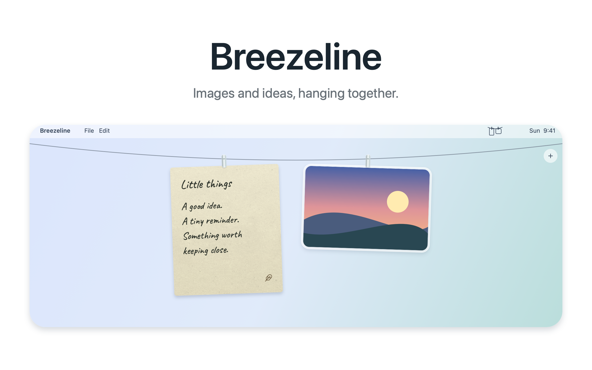

# Breezeline

<picture>
  <source media="(prefers-color-scheme: dark)" srcset="docs/images/hero-dark.png">
  
</picture>

Screenshots, clipboard images, and handwritten notes on one desktop clothesline.
A single menu-bar app for macOS 14 and later, with universal Apple silicon / Intel builds.

## Install

Download the DMG from [GitHub Releases](https://github.com/aaronyanx/Breezeline/releases/latest),
open it, and drag Breezeline into Applications. Quit older versions before opening the new app.
The initial release is ad hoc signed and has not been notarized by Apple; macOS may block its first launch.

## Features

- Rest the pointer in the menu bar for 0.25 seconds to slide the line down. It stays open while using the hanging cards and retracts 0.5 seconds after leaving the line area. It starts hidden and hides in full-screen apps.
- Enable **Keep Line Visible** in the menu for a persistent line; this choice survives restarts. Disable it to return to menu-bar reveal.
- New screenshots and imported clipboard images automatically reveal the line for 2.5 seconds. Moving onto the cards keeps it open; a paused line waits until resumed.
- Watch the macOS screenshot folder and optionally import clipboard images.
- Add a note from the rope's **+** button or **New Note** in the menu. Command-N works while the app is active.
- Notes autosave locally, use Caveat / Long Cang handwriting and Natural Paper texture.
- Drag individual clips to reorder photos and notes together; the arrangement survives restarts.
- Screenshot cards fit within 260 × 232 points; the rope has a deeper curve with room for full note cards.
- Click a photo to copy, double-click to open, hold to annotate, or drag the file out.
- Click a note to edit. Drag its paper out to export text; the original note stays.
- A note's cross or a drop onto Trash exports its complete JSON to Trash before removing it.
- Control-Option-T and **Pause Line / Resume Line** pause or resume the line in either mode. All interface text is English.
- macOS 26 uses native Liquid Glass for the editor and Done button; earlier systems use material controls.

## Moving from Hangline / Hangnotes

Quit both older apps before opening Breezeline. First launch copies Hangnotes' saved notes into
`~/Library/Application Support/Breezeline/notes.json`, and imports Hangline's image paths,
mixed arrangement, clipboard preference and sound preference. Existing files are preserved;
imported images continue to reference their original location. This is a one-time import,
not ongoing sync with the older apps.

New screenshot-inbox and clipboard files live in
`~/Library/Application Support/Breezeline/Screenshots/`.
The screenshot handling preference is offered again for the new app and restores
the previous macOS settings on quit. Login registration and macOS privacy permissions
belong to Breezeline and must be enabled separately.

## Build / package

```sh
bash scripts/build-app.sh
bash scripts/make-dmg.sh
```

Requires the Swift/macOS SDK command-line tools. SDK 26 is preferred to avoid the
missing macro plugin in the current SDK 27 Command Line Tools.
The app is ad hoc signed unless a Developer ID or `SIGN_IDENTITY` is available.
These scripts do not run tests, publish, or notarize.

## Illustrated preview

```sh
swift scripts/make-readme-art.swift
```

Generates `docs/images/hero-light.png` and `hero-dark.png` at 2400 × 1500 pixels.
The preview is drawn artwork, using the bundled handwriting font and paper texture;
it is not a capture of a running application.

## Credits

Derived from Tendedero by Alejandro Buján and the local Hangline / Hangnotes modifications.
Original source license is preserved in `LICENSE`. Breezeline has its own name and icon.
The app icon shows a textured paper note and a landscape photo; the menu-bar icon shows their simplified outlines, rope and clips.
Phosphor icons, Caveat / Long Cang fonts, and Natural Paper attribution/license notices
are bundled in app resources.
